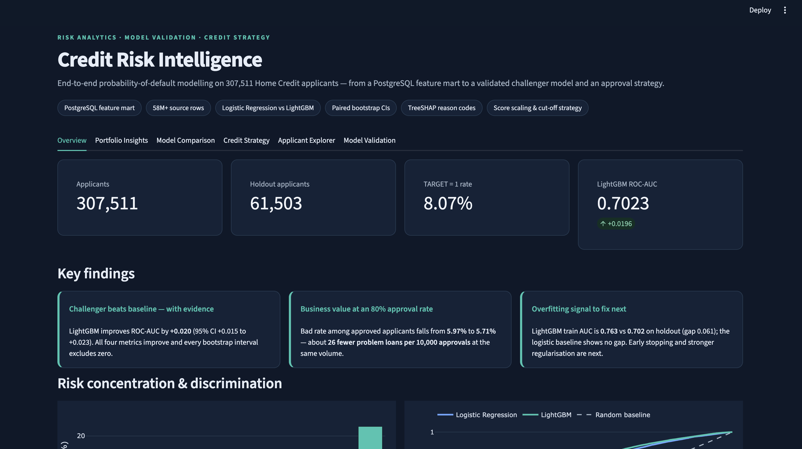
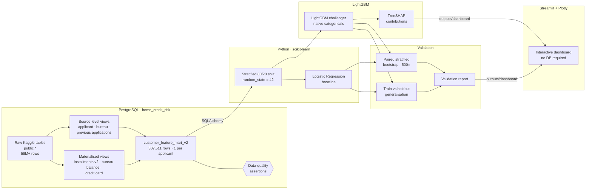

<div align="center">

# Credit Risk Intelligence

**End-to-end probability-of-default modelling on 307,511 consumer-credit applicants:
from a PostgreSQL feature mart to a validated LightGBM challenger and an interactive credit-strategy dashboard.**


[**Live demo**](#live-demo) · [**📄 Validation report (PDF)**](docs/Model_Validation_Report.pdf) · [Architecture](#architecture) · [Results](#experimental-results) · [Validation findings](#model-validation-findings) · [Limitations](#limitations) · [Run it](#getting-started)



</div>

---

## Overview

Lenders must decide, at application time, how likely an applicant is to run into repayment difficulty and what that means for approval policy. This project rebuilds that workflow end to end on the public [Home Credit Default Risk](https://www.kaggle.com/competitions/home-credit-default-risk) dataset:

1. **Data engineering in SQL:** 58M+ raw rows across 7 relational tables are aggregated into a one-row-per-applicant feature mart in PostgreSQL. Data-quality assertions run before any modelling.
2. **Modelling in Python:** an interpretable Logistic Regression baseline is compared against a LightGBM challenger on the *identical* holdout.
3. **Validation:** the improvement is tested statistically and the model is checked for overfitting, calibration, explainability and fairness.
4. **Decisioning:** probabilities are converted into scorecard points, risk grades and an approval cut-off with explicit business trade-offs, all explorable in a Streamlit app.

> **Headline:** LightGBM improves ROC-AUC from **0.683 to 0.702** (Δ +0.020, 95% CI [+0.015, +0.023]). At an 80% approval rate, it lowers the bad rate of approved loans from **5.97% to 5.71%**, about **26 fewer problem loans per 10,000 approvals**.

## Live demo

**▶ [Open the dashboard](https://share.streamlit.io/)**: _replace with your `*.streamlit.app` URL_

| Tab | What it answers |
|---|---|
| **Overview** | Headline KPIs, key findings, risk deciles, ROC curve |
| **Portfolio Insights** | Which segments carry the most risk? TARGET rate by income type, education, age, employment length, affordability, installment behaviour, bureau exposure and past refusals |
| **Model Comparison** | Is the challenger really better? ROC/PR curves, bootstrap forest plot, train-vs-holdout gap, KS chart, Lorenz/Gini curve, score distributions by outcome, decile gains table |
| **Credit Strategy** | How do we turn PDs into decisions? Scorecard scaling, A–F grades, approval-rate vs bad-rate trade-off, profit curve with adjustable economics, age-band fairness review |
| **Policy Simulator** | Do policy rules add value beyond the score? Score cut-off plus knock-out rules (installment shortfall, prior refusals, bureau exposure, affordability), decline waterfall with the bad rate of each rule's declines, and swap-set analysis of benchmark vs challenger |
| **Applicant Explorer** | Why did *this* applicant get *this* score? TreeSHAP contributions, reason codes and a live what-if simulator |
| **Model Validation** | Bank-style Green/Amber/Red validation scorecard with an overall rating, binomial calibration test per grade, Hosmer–Lemeshow, PSI/CSI stability, data-quality assertions, SHAP vs gain importance, PDF report download |

---

## Architecture



| Layer | Component | Responsibility |
|---|---|---|
| **PostgreSQL** | [`sql/01_source_features.sql`](sql/01_source_features.sql) | Applicant attributes, affordability ratios, `DAYS_EMPLOYED` sentinel fix; bureau and previous-application aggregates |
| | [`sql/02_behavioural_features.sql`](sql/02_behavioural_features.sql) | Materialised views over the largest tables (installments 13.6M, bureau balance 27.3M, credit card 3.8M rows) |
| | [`sql/03_feature_mart.sql`](sql/03_feature_mart.sql) | `risk_analytics.customer_feature_mart_v2`: the modelling grain, one row per applicant |
| | [`sql/04_data_quality_checks.sql`](sql/04_data_quality_checks.sql) | Grain, label completeness, TARGET rate, sentinel handling, ratio ranges, source coverage |
| **Python** | [`train_model.py`](train_model.py) | Extract the mart, enforce assertions, fit the Logistic Regression baseline, persist holdout IDs |
| **LightGBM** | [`compare_models.py`](compare_models.py) | Fit the challenger and **assert** that holdout IDs and labels are identical to the baseline |
| **Validation** | [`validate_models.py`](validate_models.py) · [`check_generalization.py`](check_generalization.py) | Bootstrap confidence intervals, risk concentration, Markdown report, overfitting check |
| **Serving** | [`build_dashboard_data.py`](build_dashboard_data.py) | TreeSHAP values, segment statistics, PSI/CSI, data-quality results, portable `lightgbm_model.txt` |
| **Validation library** | [`risk_metrics.py`](risk_metrics.py) | KS, Lorenz/Gini, gains table, Hosmer–Lemeshow, binomial grade test, PSI, score scaling and the RAG scorecard rules, shared by the app and the report |
| **Reporting** | [`build_validation_report.py`](build_validation_report.py) | Renders the 10-page [Model Validation Report](docs/Model_Validation_Report.pdf) (HTML → PDF) |
| **Streamlit** | [`app.py`](app.py) | Seven-tab dashboard; reads only `outputs/`, so it deploys without database access |

### Feature engineering highlights

| Feature family | Examples | Engineering decision |
|---|---|---|
| Affordability | `credit_to_income`, `annuity_to_income` | Ratios computed in SQL with divide-by-zero guards |
| Employment | `employment_years`, `employment_sentinel_flag` | `DAYS_EMPLOYED = 365243` (≈1,000 years, used for pensioners and unemployed applicants) recoded to NULL plus an explicit flag |
| Repayment behaviour | `due_date_shortfall_rate`, `multiple_payment_count` | Partial payments are first collapsed to **one row per installment**, then the query checks whether the amount due was paid *by the due date*. This removes the double counting in the v1 row-level lateness metric |
| Credit bureau | `active_loan_count`, `bureau_loan_count`, `avg_bureau_credit` | Missing bureau history is coalesced to 0 counts |
| Application history | `refused_count`, `approval_rate` | Prior Home Credit decisions |
| Excluded | `age_years` | Deliberately **not** a model input; used only for the fairness review |

Source coverage in the mart: bureau 85.7%, previous applications 94.7%, installment history 94.8%.

---

## Experimental results

**Setup:** stratified random 80/20 split (`random_state = 42`). Training set 246,008 applicants; holdout 61,503; holdout TARGET rate 8.07%. Both models use the same 25 features and are scored on the same holdout applicant IDs.

| Model | Configuration |
|---|---|
| Logistic Regression | Median imputation + missing indicators, standard scaling, one-hot encoding, `max_iter = 2000` |
| LightGBM | 350 trees, learning rate 0.05, 31 leaves, `min_child_samples = 100`, 85% row/column subsampling, L2 = 1.0, native categorical handling |

### Discrimination and accuracy (holdout)

| Metric | Logistic Regression | LightGBM | Δ (LightGBM − LR) | 95% bootstrap CI for Δ |
|---|---:|---:|---:|---:|
| ROC-AUC ↑ | 0.6827 | **0.7023** | +0.0196 | [+0.0154, +0.0233] |
| PR-AUC ↑ | 0.1628 | **0.1846** | +0.0218 | [+0.0163, +0.0267] |
| KS ↑ | 0.2690 | **0.3009** | +0.0319 | [+0.0206, +0.0401] |
| Brier score ↓ | 0.0716 | **0.0707** | −0.0009 | [−0.0011, −0.0007] |

### Risk concentration

| Indicator (top 10% riskiest) | Logistic Regression | LightGBM |
|---|---:|---:|
| Observed TARGET rate | 19.49% | **21.48%** |
| Lift vs portfolio | 2.41× | **2.66×** |
| Share of all positive cases captured | 24.15% | **26.61%** |

### From probability to decision

PDs are scaled to scorecard points: **600 points at 20:1 good:bad odds, and every 20 points doubles the odds**. LightGBM risk grades on the holdout:

| Grade | Score | Share | Observed rate | Mean predicted PD |
|:---:|:---:|---:|---:|---:|
| A | ≥ 630 | 2.4% | 1.2% | 1.4% |
| B | 610–629 | 14.9% | 2.7% | 2.7% |
| C | 590–609 | 35.4% | 4.7% | 4.9% |
| D | 570–589 | 30.5% | 9.3% | 8.9% |
| E | 550–569 | 13.2% | 16.3% | 15.9% |
| F | < 550 | 3.6% | 27.3% | 28.4% |

The observed rate rises **monotonically** from A to F, with a **22× spread**, and tracks the predicted PD in every grade.

**Approval policy at an 80% approval rate** (score cut-off ≈ 573):

| | Logistic Regression | LightGBM |
|---|---:|---:|
| Bad rate of approved applicants | 5.97% | **5.71%** |
| Share of problem loans declined | 40.9% | **43.4%** |

Illustrative economics, assuming 10% net revenue on good loans and a 50% loss on problem loans (both as a share of credit amount): the break-even PD is 16.7% and the profit-maximising approval rate is about 90%. The dashboard lets users change both assumptions.

---

## Model Validation Findings

The full **[10-page Model Validation Report (PDF)](docs/Model_Validation_Report.pdf)** follows the structure of a bank model-risk review: executive summary, scope, data quality, discrimination, calibration, robustness, explainability, fairness, findings and conditions for approval.

### Validation scorecard: LightGBM

| Test | Result | Status |
|---|---|:---:|
| Discrimination (Gini) | 0.405 | 🟢 Green |
| Separation (KS) | 0.301 | 🟢 Green |
| Benchmark significance | ΔAUC +0.020, 95% CI [+0.015, +0.023] | 🟢 Green |
| Overfitting (train − holdout AUC) | 0.061 | 🔴 Red |
| Calibration (binomial test per grade) | 6/6 grades pass · Hosmer–Lemeshow p = 0.099 | 🟢 Green |
| Rank ordering | Observed rate A → F: 1.2% → 27.3%, strictly monotonic | 🟢 Green |
| Stability (score PSI, train vs holdout) | 0.0002 | 🟢 Green |
| Fairness (age-band impact ratio at 80% approval) | 0.61 for applicants under 25 | 🟠 Amber |
| Data quality | 8/8 assertions pass | 🟢 Green |
| Out-of-time performance | No application dates in the data | ⚪ Not assessed |
| Point-in-time feature audit | Behavioural aggregates not yet audited | ⚪ Not assessed |

**Overall rating: Not approved for production.** Thresholds are listed in the report appendix.

### Key findings

| ID | Severity | Finding | Recommendation |
|---|:---:|---|---|
| F-01 | 🔴 High | **Overfitting:** train AUC 0.763 vs holdout 0.702; the benchmark shows no gap | Early stopping and regularisation tuned on a separate validation fold; re-validate |
| F-02 | 🔴 High | **No out-of-time validation:** the dataset has no application dates | Out-of-time test and monthly PSI on dated applications |
| F-03 | 🔴 High | **Point-in-time leakage risk** in installment, bureau and previous-application aggregates | Restrict aggregates to records dated before each application |
| F-04 | 🟠 Medium | **Age-band disparity:** under-25 approval rate 59% vs 97% for 65+ (impact ratio 0.61), mirroring higher observed risk | Document the business justification; test proxy features; monitor by age |
| F-05 | 🟠 Medium | **Holdout reuse** across model comparison | Reserve an untouched test sample for final approval |
| F-06 | ⚪ Low | **Label definition:** TARGET is payment difficulty, not Basel / IFRS 9 default | Map to 90+ DPD before regulatory use |
| F-07 | ⚪ Low | **Illustrative economics** in cut-off analysis | Use product-level margin, LGD and funding cost |

The benchmark (Logistic Regression) fails the binomial test in grade E and is rejected by Hosmer–Lemeshow (p = 0.008), so the challenger is also better calibrated.

### Credit-policy insight

The Policy Simulator shows that adding knock-out rules on top of the score usually **does not** pay. With a 570 cut-off plus "due-date shortfall > 30%" and "4+ prior refusals", the approved bad rate is 5.73% at a 75.5% approval rate. A pure LightGBM cut-off at the same approval rate gives 5.35%, because the score already prices that information. In a swap-set at 80% approval, LightGBM swaps in 3,230 applicants with a 10.0% bad rate and swaps out 3,230 with a 13.9% bad rate.

---

## Limitations

- **Random, not chronological, holdout.** Without application dates, temporal drift and out-of-time performance cannot be measured. Real-world performance is likely to be lower.
- **Holdout reuse.** The same holdout was used to compare models, so further tuning against it would introduce selection bias. Hyper-parameter search needs a separate validation fold.
- **Point-in-time leakage risk.** Installment, bureau and previous-application aggregates use all available history. Whether every record existed *before* the application date has not been audited.
- **Label definition.** Home Credit `TARGET` flags payment difficulty. It is not a Basel or IFRS 9 default definition, so PDs here are not regulatory PDs.
- **Overfitted challenger.** LightGBM's 0.061 AUC gap means the reported lift is a lower bound on what a regularised model may achieve, and an upper bound on what this exact model will sustain.
- **Illustrative economics.** The profit curve uses credit amount as exposure, user-set margin and loss rates, and no funding, operating or acquisition costs.
- **Fairness scope.** Only age is reviewed. Gender and other protected attributes, plus formal disparate-impact testing, are out of scope.
- **Not a decisioning system.** This is a research and portfolio project.

## Roadmap

- [ ] Early stopping and Bayesian hyper-parameter search on a dedicated validation fold to close the generalisation gap
- [ ] Mart v3: add the already-materialised bureau-balance and credit-card behaviour features
- [ ] Monotonic constraints on key risk drivers; a WoE/IV logistic scorecard as a third, fully transparent benchmark
- [ ] Isotonic calibration and monthly PSI monitoring on dated applications
- [ ] CI pipeline that runs the SQL data-quality checks and unit tests on every push

---

## Getting started

### Option A: run the dashboard (no database needed)

All dashboard inputs are committed in `outputs/`.

```bash
git clone https://github.com/NVPhg/credit-risk-platform.git
cd credit-risk-platform
python3 -m venv .venv && source .venv/bin/activate
pip install -r requirements.txt
streamlit run app.py
```

Then open <http://localhost:8501>.

### Option B: reproduce the full pipeline from raw data

**Prerequisites:** PostgreSQL 15+ (developed on Postgres.app, PostgreSQL 19), Python 3.13, about 5 GB of free disk space (the loaded database is ~4 GB).

1. **Load the raw data.** Download the CSVs from the [Kaggle competition](https://www.kaggle.com/competitions/home-credit-default-risk/data). Create a database named `home_credit_risk` and load each CSV into the `public` schema, keeping the original table and column names (`application_train`, `bureau`, `bureau_balance`, `previous_application`, `installments_payments`, `credit_card_balance`, `pos_cash_balance`).
2. **Build the feature mart and run the data-quality checks.**
   ```bash
   for f in sql/0*.sql; do psql -d home_credit_risk -v ON_ERROR_STOP=1 -f "$f"; done
   ```
   Expected output includes `307511 | 307511` (grain) and `0.0807` (TARGET rate).
3. **Train, validate and build the dashboard assets.**
   ```bash
   python train_model.py           # Logistic Regression baseline
   python compare_models.py        # LightGBM challenger on the same holdout
   python validate_models.py       # bootstrap CIs + validation report
   python check_generalization.py  # train vs holdout gap
   python build_dashboard_data.py  # SHAP, segments, PSI, data quality, portable model
   python build_validation_report.py  # 10-page PDF validation report
   ```
4. **Launch the app** with `streamlit run app.py`.

> The scripts connect through the local Unix socket (`postgresql+psycopg2://<os-user>@/home_credit_risk?host=/tmp`). If your PostgreSQL runs elsewhere, edit the connection string at the top of each script.

### Repository structure

```
credit-risk-platform/
├── app.py                        # Streamlit dashboard (7 tabs)
├── risk_metrics.py               # KS, Gini, HL, binomial, PSI, RAG rules
├── build_validation_report.py    # bank-style validation report (PDF)
├── train_model.py                # baseline: Logistic Regression
├── compare_models.py             # challenger: LightGBM
├── validate_models.py            # paired bootstrap + validation report
├── check_generalization.py       # train vs holdout gap
├── build_dashboard_data.py       # SHAP, segments, portable model
├── sql/                          # PostgreSQL feature mart + data-quality checks
├── outputs/                      # metrics, comparison tables, report, charts
│   └── dashboard/                # compact assets read by the app
├── docs/
│   ├── Model_Validation_Report.pdf
│   └── screenshots/
├── .streamlit/config.toml        # dark theme
├── requirements.txt
└── packages.txt                  # system deps for Streamlit Community Cloud
```

## Tech stack

**Data:** PostgreSQL · SQL (CTEs, `FILTER` aggregates, materialised views) · SQLAlchemy
**Modelling:** Python · pandas · NumPy · scikit-learn · LightGBM · TreeSHAP
**Validation:** stratified bootstrap · KS · PR-AUC · Brier score · calibration · impact ratio
**App:** Streamlit · Plotly

---

<sub>Research and portfolio project. Data: Home Credit Default Risk (Kaggle). TARGET is a payment-difficulty indicator, not a regulatory default definition. Not an approved credit decisioning system.</sub>
