<div align="center">

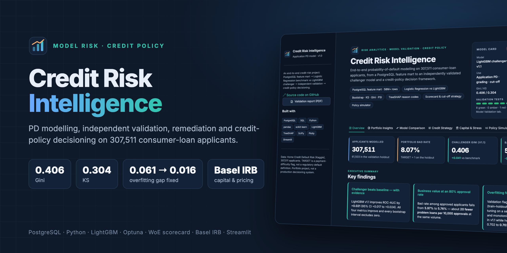

# Credit Risk Intelligence

**End-to-end probability-of-default modelling on 307,511 consumer-credit applicants:
a PostgreSQL feature mart, four competing models, a bank-style independent validation with a full
remediation cycle, Basel IRB capital and risk-based pricing, and an interactive credit-policy dashboard.**


[**Live demo**](#live-demo) · [**📄 Validation report (PDF)**](docs/Model_Validation_Report.pdf) · [Architecture](#architecture) · [Results](#experimental-results) · [Validation findings](#model-validation-findings) · [Capital & pricing](#capital-pricing-and-stress-testing) · [Limitations](#limitations) · [Run it](#getting-started)

</div>

---

## Overview

Lenders must decide, at application time, how likely an applicant is to run into repayment difficulty, whether the model behind that decision can be trusted, and what the decision means for losses, capital and price. This project rebuilds that whole workflow on the public [Home Credit Default Risk](https://www.kaggle.com/competitions/home-credit-default-risk) dataset:

1. **Data engineering in SQL:** 58M+ raw rows across 7 relational tables become a one-row-per-applicant feature mart in PostgreSQL, guarded by data-quality assertions.
2. **Four models, one holdout:** a logistic regression benchmark, a traditional **WoE / IV scorecard**, the original **LightGBM v1.0** challenger and the remediated **LightGBM v1.1**, all scored on identical, programmatically verified holdout IDs.
3. **Independent validation:** an 11-test Green / Amber / Red scorecard (discrimination, bootstrap significance, overfitting, calibration, rank ordering, stability, fairness, data quality) and a 12-page [validation report](docs/Model_Validation_Report.pdf).
4. **Remediation cycle:** v1.0 failed on overfitting. v1.1 was retrained with Optuna on a separate validation fold, early stopping and **monotonic constraints**, then re-validated. The fix worked, and the re-validation also caught a new fairness regression.
5. **Credit policy and economics:** scorecard points, A–F grades, cut-off strategy, a knock-out-rule simulator with swap-set analysis, **Basel IRB capital, expected loss, risk-based pricing and stress testing**.

> **Headline:** the remediated LightGBM v1.1 reaches **Gini 0.406 / KS 0.304** (logistic benchmark 0.365 / 0.269; ΔAUC +0.021, 95% CI [+0.017, +0.024]) and cuts the train–holdout gap from **0.061 to 0.016**. Validation still rates it **Not approved**: the under-25 approval impact ratio slipped to 0.59, below the Red threshold. That is the kind of trade-off an independent validator exists to catch.

## Live demo

**▶ [Open the dashboard](https://share.streamlit.io/)**: _replace with your `*.streamlit.app` URL_

| Tab | What it answers |
|---|---|
| **Overview** | Model card with live validation status, KPIs, key findings, risk deciles, ROC |
| **Portfolio Insights** | Which segments carry the most risk? TARGET rate by income, education, age, employment, affordability, repayment behaviour, bureau exposure and past refusals |
| **Model Comparison** | Four-model benchmark, bootstrap forest plot, generalisation gap, KS, Lorenz/Gini, score distributions, gains table, **WoE / IV scorecard** with IV chart and points table |
| **Credit Strategy** | Score scaling, A–F grades, approval-rate vs bad-rate trade-off, profit curve, age-band fairness |
| **Capital & Stress** | **Basel IRB capital, expected loss, RWA, minimum risk-based rate per grade vs a rate cap, and a three-scenario stress test** |
| **Policy Simulator** | Do knock-out rules add value beyond the score? Decline waterfall and swap-set analysis |
| **Applicant Explorer** | Credit decision (approve / refer / decline) with adverse-action reason codes, TreeSHAP contributions and a live what-if simulator |
| **Model Validation** | RAG scorecard for any model, **v1.0 → v1.1 remediation view with the Optuna search**, calibration tests, PSI/CSI, data quality, PDF report |

### Screenshots

| | |
|:---:|:---:|
| 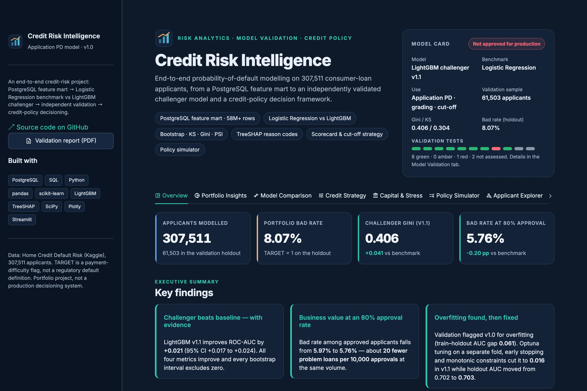 | 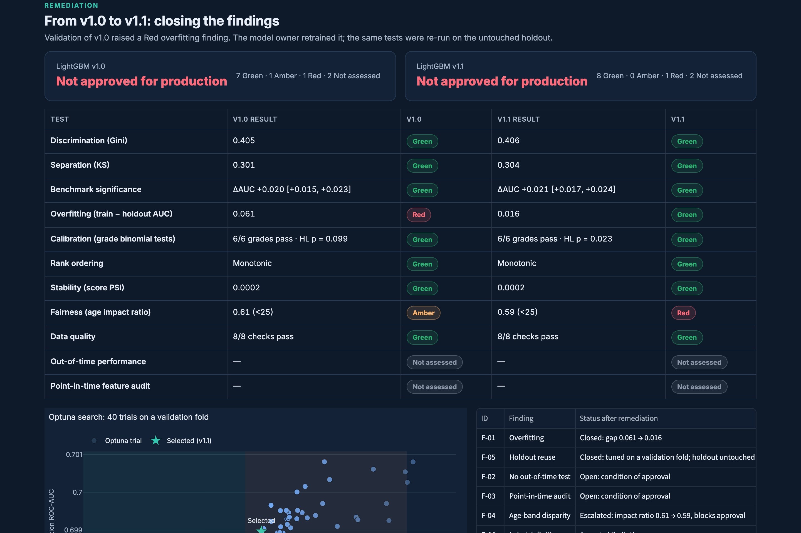 |
| **Overview:** model card, KPIs and key findings | **Remediation:** v1.0 vs v1.1 test by test |
| 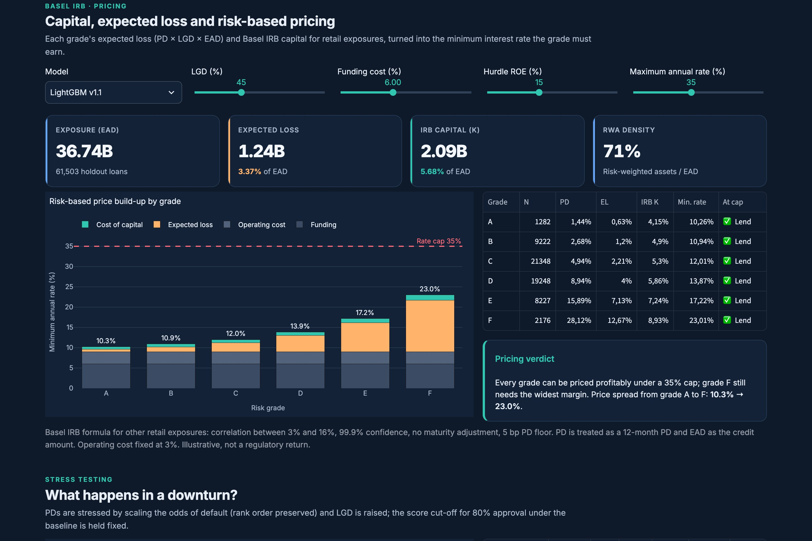 | 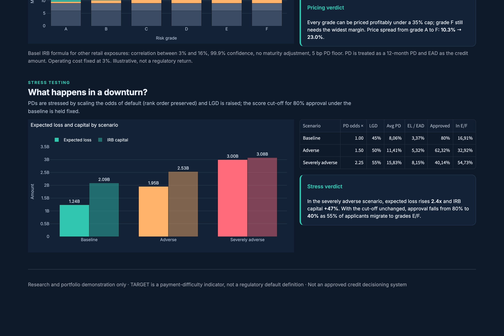 |
| **Capital & pricing:** Basel IRB and risk-based price by grade | **Stress test:** EL, capital and approval under downturn |
| 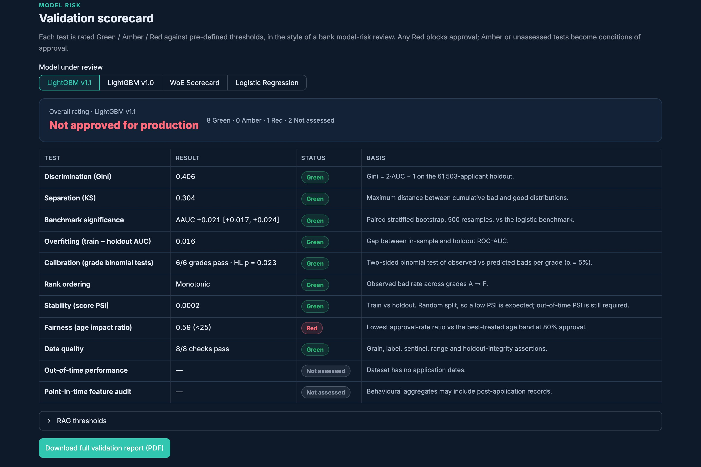 | 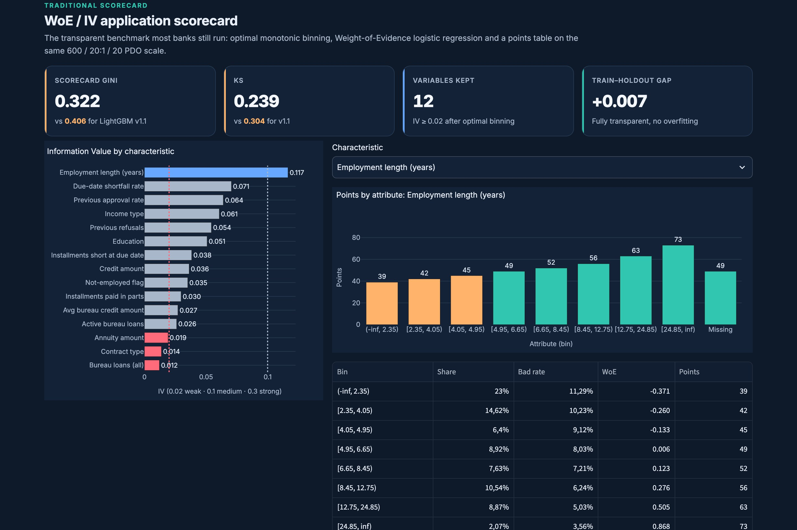 |
| **Validation scorecard:** Green/Amber/Red tests and rating | **WoE scorecard:** Information Value and points table |
| 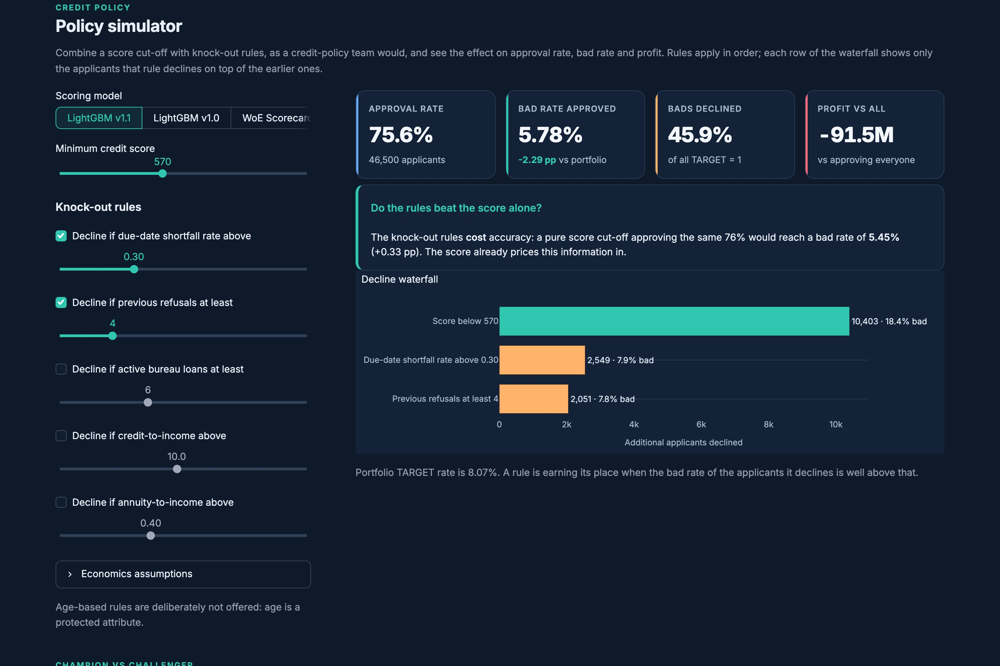 | 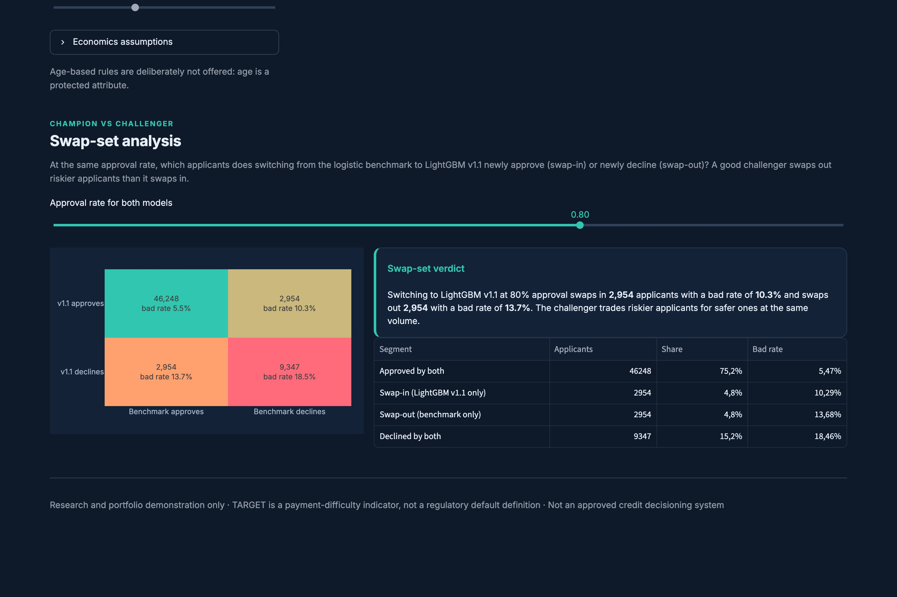 |
| **Policy Simulator:** knock-out rules and decline waterfall | **Swap-set:** benchmark vs challenger at equal approval |
| 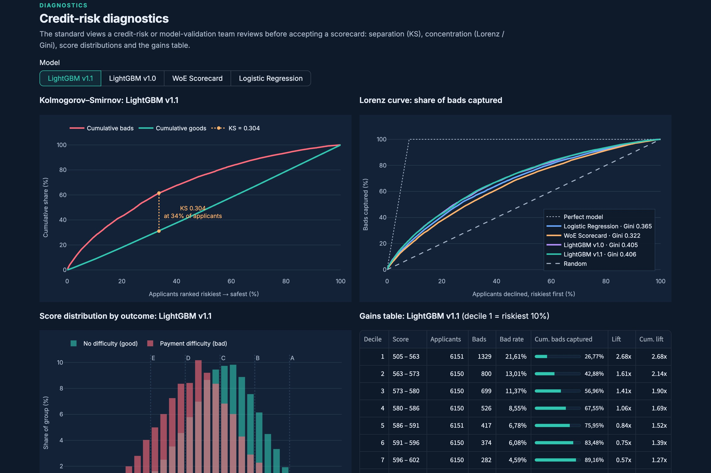 | 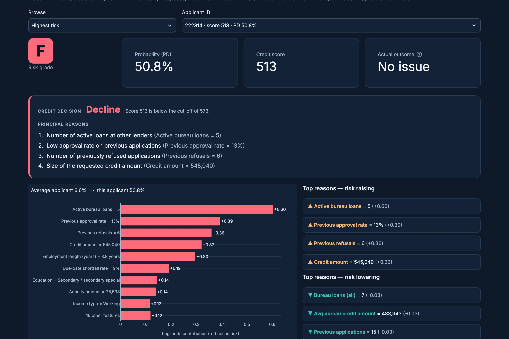 |
| **Diagnostics:** KS, Lorenz/Gini, score distribution, gains | **Applicant Explorer:** decision with reason codes |

---

## Architecture

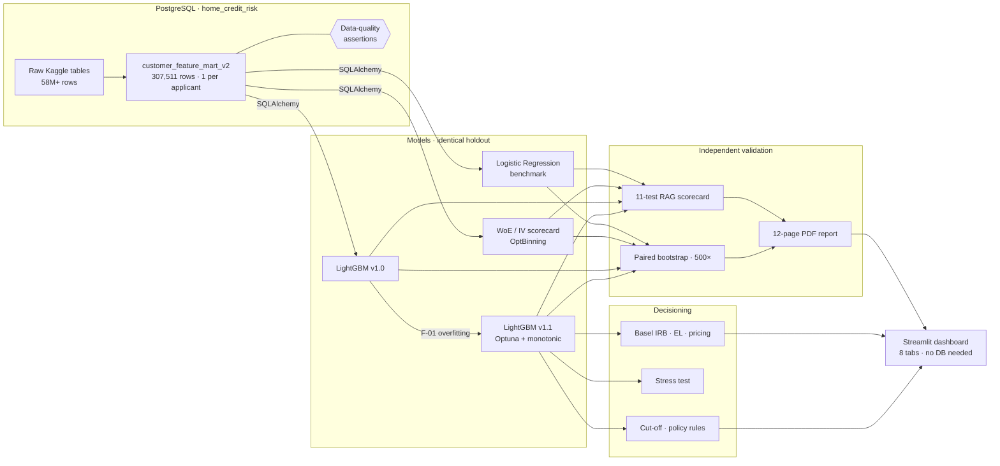

| Layer | Component | Responsibility |
|---|---|---|
| **PostgreSQL** | [`sql/`](sql/) | Source views, materialised behavioural aggregates (installments 13.6M, bureau balance 27.3M, credit card 3.8M rows), the modelling mart and [data-quality checks](sql/04_data_quality_checks.sql) |
| **Benchmark** | [`train_model.py`](train_model.py) | Logistic regression; persists the holdout IDs every other model must reuse |
| **Challenger v1.0** | [`compare_models.py`](compare_models.py) | Original LightGBM; asserts identical holdout IDs and labels |
| **Validation** | [`validate_models.py`](validate_models.py) · [`check_generalization.py`](check_generalization.py) | Bootstrap confidence intervals, risk concentration, train-vs-holdout gap |
| **Remediation v1.1** | [`tune_challenger.py`](tune_challenger.py) | Optuna (TPE, 40 trials) on a validation fold, early stopping, monotonic constraints, gap-penalised objective; bootstrap vs logistic and vs v1.0 |
| **Scorecard** | [`build_scorecard.py`](build_scorecard.py) | Optimal monotonic binning, IV selection, WoE logistic regression, points table on the same scale |
| **Risk library** | [`risk_metrics.py`](risk_metrics.py) | KS, Lorenz/Gini, gains, Hosmer–Lemeshow, binomial grade test, PSI, RAG rules, paired bootstrap, **Basel IRB K, EL, pricing, stress test** |
| **Serving** | [`build_dashboard_data.py`](build_dashboard_data.py) | TreeSHAP, PSI/CSI for all models, segment risk, data quality, portable models |
| **Reporting** | [`build_validation_report.py`](build_validation_report.py) | Renders the [Model Validation Report](docs/Model_Validation_Report.pdf) (HTML → PDF) |
| **App** | [`app.py`](app.py) | Eight-tab Streamlit dashboard; reads only `outputs/`, so it deploys without database access |

### Feature engineering highlights

| Feature family | Examples | Engineering decision |
|---|---|---|
| Affordability | `credit_to_income`, `annuity_to_income` | Ratios computed in SQL with divide-by-zero guards |
| Employment | `employment_years`, `employment_sentinel_flag` | `DAYS_EMPLOYED = 365243` (≈1,000 years) recoded to NULL plus an explicit flag |
| Repayment behaviour | `due_date_shortfall_rate` | Partial payments collapsed to one row per installment before testing whether the amount due was paid by the due date |
| Credit bureau | `active_loan_count`, `avg_bureau_credit` | Missing history coalesced to 0 counts |
| Application history | `refused_count`, `approval_rate` | Prior Home Credit decisions |
| Excluded | `age_years` | Never a model input; used only for the fairness review |

---

## Experimental results

**Setup:** stratified 80/20 split (`random_state = 42`), 246,008 training and 61,503 holdout applicants, holdout TARGET rate 8.07%. v1.1 was tuned on a 20% validation fold carved out of the training sample, so the holdout stayed untouched until the final evaluation.

### Four-model benchmark (holdout)

| Model | ROC-AUC | Gini | KS | PR-AUC | Brier ↓ | Train–holdout gap |
|---|---:|---:|---:|---:|---:|---:|
| **LightGBM v1.1** (remediated) | **0.7032** | **0.406** | **0.304** | 0.1818 | 0.0707 | **+0.016** |
| LightGBM v1.0 | 0.7023 | 0.405 | 0.301 | **0.1846** | 0.0707 | +0.061 |
| Logistic Regression | 0.6827 | 0.365 | 0.269 | 0.1628 | 0.0716 | −0.003 |
| WoE / IV Scorecard | 0.6608 | 0.322 | 0.239 | 0.1494 | 0.0722 | +0.007 |

- **v1.1 vs logistic** (paired bootstrap, 500 resamples): ΔAUC **+0.021** [+0.017, +0.024]. All four metrics improve with intervals that exclude zero.
- **v1.1 vs v1.0:** ΔAUC +0.0009 [−0.0008, +0.0029], which is inconclusive. **Remediation removed the overfitting without losing discrimination.**
- **Price of transparency:** the WoE scorecard keeps 12 characteristics and has no overfitting, but gives up 0.08 Gini points versus v1.1.

### From probability to decision (LightGBM v1.1)

PDs are scaled to points: **600 at 20:1 good:bad odds, 20 points to double the odds**.

| Grade | Score | Observed bad rate |
|:---:|:---:|---:|
| A | ≥ 630 | 1.5% |
| B | 610–629 | 2.6% |
| C | 590–609 | 4.7% |
| D | 570–589 | 9.3% |
| E | 550–569 | 16.1% |
| F | < 550 | 27.3% |

- At **80% approval**, the approved bad rate is **5.76%** vs 5.97% for the logistic benchmark, about **20 fewer problem loans per 10,000 approvals**.
- **Swap-set:** at the same 80% approval, v1.1 swaps in 2,954 applicants with a 10.3% bad rate and swaps out 2,954 with a 13.7% bad rate.
- **Policy insight:** a 570 cut-off plus knock-out rules (shortfall > 30%, 4+ refusals) gives a 5.78% bad rate at 75.6% approval. A pure score cut-off at the same approval gives **5.45%**. The rules destroy value because the score already prices that information.

---

## Model Validation Findings

The full **[12-page Model Validation Report (PDF)](docs/Model_Validation_Report.pdf)** follows a bank model-risk structure: executive summary, findings register, remediation, scope and data, discrimination, calibration, stability, fairness, business use (capital and pricing), conditions of approval and appendix.

### Validation scorecard: v1.0 → v1.1

| Test | v1.0 | v1.1 |
|---|:---:|:---:|
| Discrimination (Gini) | 🟢 0.405 | 🟢 0.406 |
| Separation (KS) | 🟢 0.301 | 🟢 0.304 |
| Benchmark significance (ΔAUC CI) | 🟢 [+0.015, +0.023] | 🟢 [+0.017, +0.024] |
| **Overfitting (train − holdout AUC)** | 🔴 **0.061** | 🟢 **0.016** |
| Calibration (binomial test per grade) | 🟢 6/6 | 🟢 6/6 |
| Rank ordering | 🟢 monotonic | 🟢 monotonic |
| Stability (score PSI) | 🟢 0.0002 | 🟢 0.0002 |
| **Fairness (age impact ratio at 80% approval)** | 🟠 0.61 | 🔴 **0.59** |
| Data quality | 🟢 8/8 | 🟢 8/8 |
| Out-of-time / point-in-time audit | ⚪ not assessable | ⚪ not assessable |
| **Overall rating** | **Not approved** | **Not approved** |

Rule: any Red blocks approval; Amber or unassessed tests become conditions of approval.

### Findings register

| ID | Severity | Finding | Status |
|---|:---:|---|---|
| F-01 | 🔴 High | Overfitting in v1.0 (gap 0.061) | ✅ **Closed in v1.1** (gap 0.016) |
| F-05 | 🟠 Medium | Holdout reused for model selection | ✅ **Closed in v1.1** (tuned on a validation fold) |
| F-04 | 🔴 High | **Age-band disparity escalated:** under-25 impact ratio 0.61 → 0.59 | ⛔ Open, blocks approval |
| F-02 | 🔴 High | No out-of-time validation (no application dates) | Open, condition of approval |
| F-03 | 🔴 High | Point-in-time leakage risk in behavioural aggregates | Open, condition of approval |
| F-06 | ⚪ Low | TARGET is payment difficulty, not Basel / IFRS 9 default | Accepted limitation |
| F-07 | ⚪ Low | Illustrative economics | Accepted limitation |

**What the remediation teaches:** the stronger regularisation in v1.1 leans harder on employment length, a proxy for age, and pushed the under-25 impact ratio across the Red line. The validator's job is to re-run *every* test after a fix, not only the one that failed. The next iteration is a fairness remediation, such as segment-level cut-offs or a reweighted retrain.

---

## Capital, pricing and stress testing

PDs from v1.1 feed a Basel IRB view of the portfolio (EAD = credit amount, LGD 45%):

- **Expected loss** = PD × LGD × EAD: **3.37%** of exposure.
- **Basel IRB capital (other retail)**: K = LGD·N[(G(PD) + √R·G(0.999)) / √(1−R)] − PD·LGD, with correlation R between 3% and 16% and a 5 bp PD floor. This gives **5.68%** of exposure and an RWA density of 71%.
- **Risk-based pricing**: minimum annual rate = funding (6%) + operating cost (3%) + EL + 15% return on IRB capital. It ranges from **10.3% for grade A to 23.0% for grade F**. The dashboard flags any grade that cannot be priced under a user-set rate cap.

| Stress scenario | PD odds | LGD | EL / EAD | IRB capital | Approval at fixed cut-off | Share in grades E/F |
|---|---:|---:|---:|---:|---:|---:|
| Baseline | ×1.00 | 45% | 3.37% | 2.09B | 80.0% | 16.9% |
| Adverse | ×1.50 | 50% | 5.32% | 2.53B | 62.3% | 32.9% |
| Severely adverse | ×2.25 | 55% | 8.15% | 3.08B | 40.1% | 54.7% |

---

## Limitations

- **Random, not chronological, holdout:** out-of-time performance and drift cannot be measured.
- **Point-in-time leakage risk:** behavioural aggregates use all available history.
- **Label definition:** `TARGET` is payment difficulty, not a Basel or IFRS 9 default. PDs are treated as 12-month PDs for illustration.
- **Fairness scope:** only age is reviewed, and v1.1 currently fails that review.
- **Illustrative economics:** LGD, funding, operating cost, hurdle rate and stress multipliers are assumptions, not calibrated values.
- **Not a decisioning system:** this is a research and portfolio project.

## Roadmap

- [x] Close the overfitting finding: Optuna on a validation fold, early stopping, monotonic constraints (v1.1)
- [x] WoE / IV scorecard as a transparent benchmark
- [x] Basel IRB capital, expected loss, risk-based pricing and stress testing
- [ ] Fairness remediation for F-04 (segment-level cut-offs or reweighted retrain) and re-validation
- [ ] Mart v3 with the already-materialised bureau-balance and credit-card features
- [ ] Simulated monthly monitoring: PSI/CSI drift alerts and a re-training trigger
- [ ] CI pipeline running the SQL data-quality checks and unit tests on every push

---

## Getting started

### Option A: run the dashboard (no database needed)

```bash
git clone https://github.com/NVPhg/credit-risk-platform.git
cd credit-risk-platform
python3 -m venv .venv && source .venv/bin/activate
pip install -r requirements.txt
streamlit run app.py
```

### Option B: reproduce the full pipeline from raw data

**Prerequisites:** PostgreSQL 15+ (developed on PostgreSQL 19), Python 3.13, about 5 GB of free disk space.

1. Download the [Kaggle CSVs](https://www.kaggle.com/competitions/home-credit-default-risk/data) and load them into a database named `home_credit_risk`, `public` schema, keeping the original table and column names.
2. Build the feature mart and run the data-quality checks:
   ```bash
   for f in sql/0*.sql; do psql -d home_credit_risk -v ON_ERROR_STOP=1 -f "$f"; done
   ```
3. Install the pipeline extras and run the steps in order:
   ```bash
   pip install -r requirements-pipeline.txt
   python train_model.py           # logistic benchmark
   python compare_models.py        # LightGBM v1.0
   python validate_models.py       # bootstrap CIs (v1.0)
   python check_generalization.py  # train vs holdout gap
   python tune_challenger.py       # LightGBM v1.1 remediation (~5 min)
   python build_scorecard.py       # WoE / IV scorecard
   python build_dashboard_data.py  # SHAP, PSI, segments, data quality
   python build_validation_report.py  # 12-page PDF
   ```
4. Optional: with the app running, refresh the README visuals with `python scripts/capture_screenshots.py && python scripts/make_banner.py`.

### Repository structure

```
credit-risk-platform/
├── app.py                        # Streamlit dashboard (8 tabs)
├── risk_metrics.py               # metrics, validation tests, RAG rules, Basel IRB, stress
├── train_model.py                # logistic benchmark
├── compare_models.py             # LightGBM v1.0
├── validate_models.py            # paired bootstrap (v1.0)
├── check_generalization.py       # train vs holdout gap
├── tune_challenger.py            # LightGBM v1.1: Optuna + monotonic constraints
├── build_scorecard.py            # WoE / IV scorecard
├── build_dashboard_data.py       # SHAP, PSI/CSI, segments, data quality
├── build_validation_report.py    # bank-style validation report (PDF)
├── scripts/                      # screenshot capture and banner rendering
├── sql/                          # PostgreSQL feature mart + data-quality checks
├── outputs/                      # metrics, bootstrap results, scorecard tables, dashboard assets
├── docs/
│   ├── Model_Validation_Report.pdf
│   ├── banner.png
│   └── screenshots/
├── requirements.txt              # app runtime
└── requirements-pipeline.txt     # + Optuna, OptBinning for the modelling pipeline
```

## Tech stack

**Data:** PostgreSQL · SQL (CTEs, `FILTER` aggregates, materialised views) · SQLAlchemy
**Modelling:** Python · pandas · scikit-learn · LightGBM · Optuna · OptBinning (WoE / IV) · TreeSHAP
**Risk & validation:** bootstrap CIs · KS · Gini · Hosmer–Lemeshow · binomial tests · PSI/CSI · impact ratio · Basel IRB · stress testing
**App & reporting:** Streamlit · Plotly · Matplotlib · headless Chrome (PDF)

---

<sub>Research and portfolio project. Data: Home Credit Default Risk (Kaggle). TARGET is a payment-difficulty indicator, not a regulatory default definition. Not an approved credit decisioning system.</sub>
