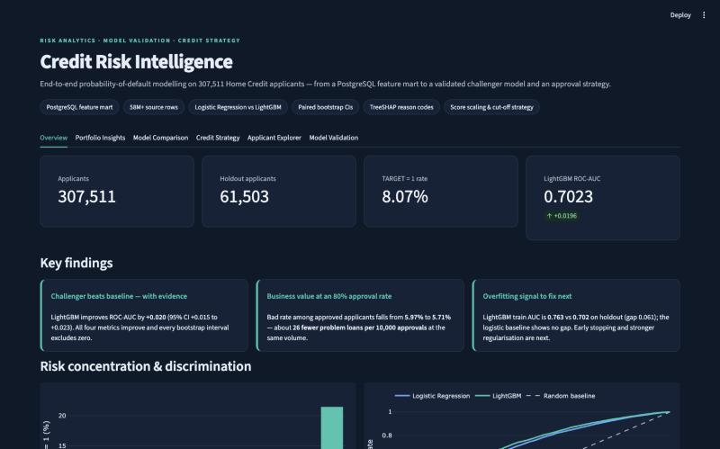

# Credit Risk Intelligence

End-to-end probability-of-default (PD) modelling on **307,511 Home Credit applicants**:
a PostgreSQL feature mart, a Logistic Regression baseline vs a LightGBM challenger,
statistical validation, explainability, and an interactive Streamlit dashboard that
turns model scores into credit decisions.

> **Live demo:** _add your Streamlit Community Cloud link here_
>
> 

---

## Results at a glance

Holdout: 61,503 applicants (stratified 20%), observed TARGET = 1 rate 8.07%.

| Metric | Logistic Regression | LightGBM | Difference (95% bootstrap CI) |
|---|---:|---:|---:|
| ROC-AUC | 0.6827 | **0.7023** | +0.0196 [+0.0154, +0.0233] |
| PR-AUC | 0.1628 | **0.1846** | +0.0218 [+0.0163, +0.0267] |
| KS | 0.2690 | **0.3009** | +0.0319 [+0.0206, +0.0401] |
| Brier score ↓ | 0.0716 | **0.0707** | −0.0009 [−0.0011, −0.0007] |

- **Every bootstrap interval excludes zero:** a paired stratified bootstrap with 500 resamples confirms the improvement on all four metrics.
- **Business impact:** at an 80% approval rate, the bad rate among approved applicants falls from **5.97% → 5.71%**, which is about **26 fewer problem loans per 10,000 approvals** at the same volume.
- **Risk concentration:** the top LightGBM decile has a **2.66x lift** and captures **26.6%** of all positive cases.
- **Honest caveat:** LightGBM's train AUC (0.763) is well above its holdout AUC (0.702), which signals overfitting. The logistic baseline shows no gap. Early stopping and stronger regularisation are the next iteration.

## What the dashboard shows

| Tab | What it answers |
|---|---|
| **Overview** | Headline KPIs, key findings, risk deciles, ROC |
| **Portfolio Insights** | TARGET rate by segment (income type, education, age, employment length, credit-to-income, installment behaviour, bureau loans, past refusals) over all 307k applicants |
| **Model Comparison** | ROC and PR curves, bootstrap forest plot of metric differences, train-vs-holdout generalisation gap |
| **Credit Strategy** | PD → scorecard points (600 @ 20:1 odds, PDO 20), A–F risk grades with a monotonicity check, approval-rate vs bad-rate trade-off, profit curve with adjustable revenue and loss assumptions, fairness review by age band (four-fifths impact ratio) |
| **Applicant Explorer** | Per-applicant TreeSHAP contributions, top risk-raising and risk-lowering reason codes, and a **what-if simulator** that re-scores the applicant live with the saved LightGBM model |
| **Model Validation** | Calibration, SHAP vs gain importance, validation checklist, bootstrap table, downloadable validation report |

## Architecture

```
Kaggle Home Credit CSVs (58M+ rows)
        │  loaded into PostgreSQL (public schema)
        ▼
sql/01_source_features.sql       applicant, bureau, previous-application views
sql/02_behavioural_features.sql  materialised views: installments, bureau balance, credit card
sql/03_feature_mart.sql          risk_analytics.customer_feature_mart_v2  (1 row / applicant)
sql/04_data_quality_checks.sql   grain, label, sentinel and range assertions
        │
        ▼
train_model.py           Logistic Regression baseline  → metrics.json, holdout IDs
compare_models.py        LightGBM challenger on identical holdout IDs (asserted)
validate_models.py       paired stratified bootstrap + Markdown validation report
check_generalization.py  train vs holdout gap
build_dashboard_data.py  TreeSHAP, segment risk, portable model → outputs/dashboard/
        │
        ▼
app.py  (Streamlit + Plotly). Reads only outputs/, so it runs without a database.
```

### Feature engineering highlights (SQL)
- **Affordability ratios:** credit-to-income, annuity-to-income.
- **Data-quality fix:** the `DAYS_EMPLOYED = 365243` sentinel (pensioners and unemployed applicants) is converted to NULL plus an explicit flag, so it is not read as 1,000 years of employment.
- **Installment behaviour v2:** partial payments are first collapsed to one row per installment. The query then measures whether the amount due was paid **by the due date** (`due_date_shortfall_rate`). This avoids the double-counting bug in the v1 row-level lateness metric.
- **Bureau monthly status:** delinquent and severe months, recent-12-month delinquency rate (materialised and ready for the next model iteration).
- **Credit cards:** DPD months, utilisation, over-limit months.

## Run it locally

```bash
python -m venv .venv && source .venv/bin/activate
pip install -r requirements.txt
streamlit run app.py
```

The dashboard assets in `outputs/` and `outputs/dashboard/` are committed, so the app starts immediately.

### Rebuild everything from raw data
1. Download the [Home Credit Default Risk](https://www.kaggle.com/competitions/home-credit-default-risk/data) CSVs and load them into a PostgreSQL database named `home_credit_risk` (the scripts connect through the local Postgres.app socket at `/tmp`).
2. Build the feature mart:
   ```bash
   for f in sql/0*.sql; do psql -d home_credit_risk -f "$f"; done
   ```
3. Run the pipeline in order:
   ```bash
   python train_model.py && python compare_models.py && python validate_models.py && python check_generalization.py && python build_dashboard_data.py
   ```

## Methodology notes and limitations
- **Leakage control:** age is excluded from both models and is used only for the fairness review. Both models are scored on the same holdout IDs, and the scripts assert this.
- **Validation design:** the holdout is a stratified random split, not out-of-time, because the dataset has no application dates. The same holdout was used to compare models, so there is a risk of selection bias.
- **Point-in-time audit outstanding:** installment-derived aggregates still need a check that each value was available at application time.
- **Label definition:** Home Credit `TARGET` is a payment-difficulty flag, not a regulatory (Basel/IFRS 9) default definition.
- **Illustrative economics:** the profit curve uses credit amount as exposure and user-set margin and loss rates.
- **Not a decision system:** this is a research and portfolio project, not an approved credit decisioning system.

## Roadmap
- [ ] Early stopping and hyper-parameter search on a separate validation fold to close the LightGBM generalisation gap
- [ ] Add bureau-balance and credit-card features (already materialised) as mart v3
- [ ] Monotonic constraints on key features and WoE/IV scorecard as a third model
- [ ] Probability calibration (isotonic) and PSI-based stability monitoring
- [ ] Unit tests for SQL data-quality checks in CI

## Tech stack
PostgreSQL · SQL (CTEs, FILTER aggregates, materialised views) · Python · pandas · scikit-learn · LightGBM · TreeSHAP · Plotly · Streamlit
